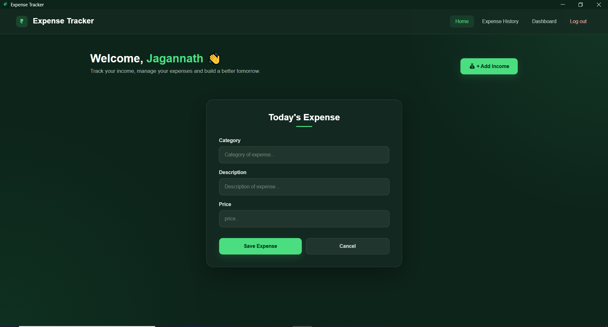

# Expense Tracker

A simple and user-friendly **Expense Tracker Desktop Application** that helps users manage their daily income and expenses in one place.

The application provides an organized dashboard, expense history, income management, and graphical representations of expenses to help users understand their financial activities.

## 🚀 Features

### 1. User Login
- Users must log in before accessing the application.
- Provides a login-based entry to the application.
- When logging out, the application asks for confirmation (Yes/No) before ending the session.

### 2. Home – Add Expense & Income
- Add new expenses by entering the required details.
- Add new income with its source, description, and amount.
- Simple interface for managing daily financial transactions.

### 3. Expense History
- View all recorded expenses.
- Display total expenses.
- Display monthly expenses.
- Delete unwanted expense records.

### 4. Dashboard
- View total income.
- View total expenses.
- Calculate and display the remaining balance.
- Update existing income records.
- Delete income records.
- View two graphical representations of expenses for better financial understanding.

## 🛠️ Technologies Used

| Technology | Purpose |
|---|---|
| HTML | Frontend structure |
| CSS | Styling and UI design |
| JavaScript | Frontend functionality |
| Python | Backend logic |
| Eel | Python and web frontend communication |
| JSON | Data storage |

## ⚙️ How It Works

1. Launch the application.
2. Log in to access the application.
3. Add income and expenses from the Home page.
4. Visit Expense History to review and delete expense records.
5. Open the Dashboard to monitor income, expenses, remaining balance, and expense graphs.
6. Log out when finished. The application asks for confirmation before logging out.

## 💡 Project Purpose

This project was developed to make personal income and expense management easier through a simple desktop interface.

It combines web technologies with Python using Eel, while JSON is used for storing application data.

## 👨‍💻 Developer

**Jagannath Prasad Dash**

- GitHub: [@jpdash33](https://github.com/jpdash33)

---

## 🖼️ Preview:

⭐ If you find this project useful, consider giving it a star!